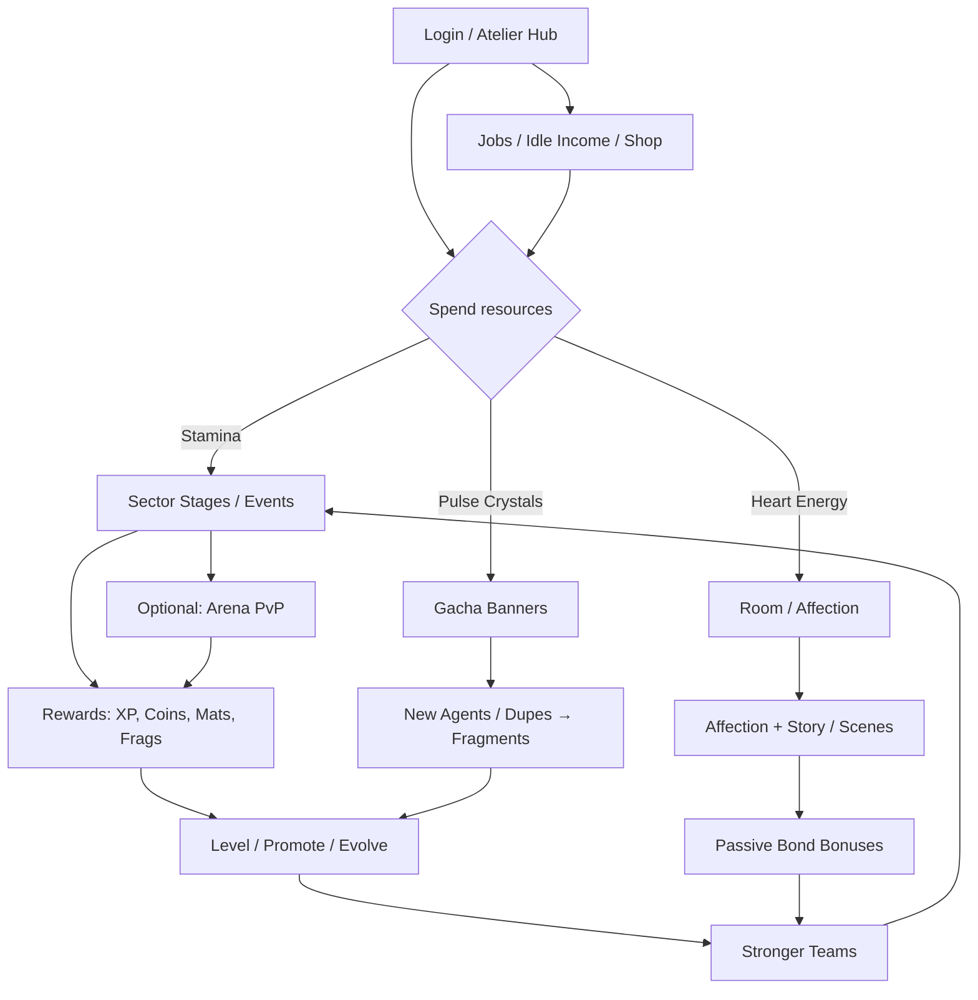

# HEARTLINE PROTOCOL
### Working Title Options
| Priority | Title | Rationale |
|----------|-------|-----------|
| **PRIMARY** | **Heartline Protocol** | Evokes connection ("heartline") + sci-fi systems ("protocol"); clean for store listings |
| Alt A | Neon Bond | Shorter, lifestyle/romance leaning |
| Alt B | Astral Atelier | Art-house / apartment-atelier fantasy |

**Document version:** 1.0 · **Status:** Pre-production pitch GDD · **Date:** 2026-09-19  
**Content policy (binding):** All romanceable / collectible characters are **adults aged 18+**. No underage characters, depictions, or implications. Adult (NSFW) content is gated behind explicit player consent, age-gate, and affection thresholds, and is described in this document at **system level only**.

---

## 1. High Concept & Fantasy

**Elevator pitch:** *Heartline Protocol* is a stylish apartment-hub gacha where you run a neon-lit residential tower for elite "Heartline Agents"—adult women bonded to you through combat sync and private Room intimacy. Match-3 board clears feed RPG skill bursts; affection unlocks story, visual evolutions, and opt-in adult scenes. Collect, train, bond, and live with your roster between stage runs and limited banners.

**High concept (1 paragraph):** In the coastal megacity of **Lumina Quay**, corporate "Heartline Corps" lease agents—specialists whose combat power scales with emotional sync to their Handler (the player). You inherit a mid-rise **Atelier Tower** apartment block, recruit agents via the **Pulse Gacha**, clear **Sector Stages** with a hybrid match-3 + RPG combat system, and deepen bonds in private **Room** sessions that unlock lore, passive bonuses, and consent-gated intimate scenes. Soft-currency grind and ethical gacha (transparent rates, hard pity, no romance hard-gates behind VIP) keep progression readable for F2P and whales alike. The fantasy is dual: tactical collector by day, trusted partner and homebody by evening—without cloning any existing IP.

---

## 2. Target Audience, Platforms, Tone & Content Rating

| Dimension | Spec |
|-----------|------|
| **Primary audience** | Adults 18–35 who enjoy character collection, light puzzle-RPG hybrids, and romance/gacha loops; prior affinity with anime aesthetics and adult mobile/PC games |
| **Secondary** | Casual collectors who play 15–30 min sessions; whales who chase limited banners + skins |
| **Platforms** | iOS / Android (portrait primary) + Windows / macOS / Steam (landscape optional UI scale); shared account; cloud save |
| **Tone** | Stylish neon-noir slice-of-life + light sci-fi conspiracy; warm apartment comedy between high-stakes Sector ops |
| **Content rating** | Store storefronts: **17+ / Mature**; in-app **Age Gate (18+)** before any NSFW unlock; separate **SFW Mode** toggle that locks Room adult scenes and softens UI |
| **Languages (launch)** | EN, JA, ZH-CN, KO (voice pack optional post-launch) |

**Explicit age policy:** Every collectible / romanceable character is written, voiced, and depicted as **18 years of age or older**. Character bios list age ≥18. Marketing and store assets follow the same rule.

---

## 3. Core Fantasy & Player Fantasy Loop

### Core fantasy
*"I am the Handler who keeps a tower of extraordinary women safe, strong, and close—winning battles together, then coming home to an apartment that feels like ours."*

### Day-in-the-life session (≈20–35 minutes)

1. **Login / Hub (2 min):** Claim idle **Atelier Income**, check mail, see daily missions, energy bar (`Stamina`).
2. **Stage push (8–12 min):** Spend Stamina on **Sector Stages** or weekly **Drift Events**. Team of 4 + 1 Support. Match-3 board feeds skill gauges; clear stage → XP, **Luma Coins**, promote mats, chance of character fragments.
3. **Home loop (5–8 min):** Assign 1–2 agents to **Jobs** (idle income). Visit **Room** with highest-affinity agent; spend **Heart Energy** on talk / gift / date mini-choice → Affection XP. If threshold hit, unlock story beat or scene (SFW or NSFW per settings).
4. **Meta (3–5 min):** Gacha pull if currency banked; check **Bond Matrix** for duo bonuses; claim VIP pass daily; peek at light **Arena** (optional 3 fights).
5. **Logout:** Queue overnight Job; leave one agent in Room "sleepover" for morning Affection bonus.

**Emotional beats per session:** competence (clear a hard stage) → collection dopamine (fragment / pull) → intimacy payoff (Room progress) → anticipation (tomorrow's energy / banner).

---

## 4. Core Gameplay Loop Diagram



**ASCII compact:**

```
[HUB]──Stamina──►[STAGES]──► rewards ──►[GROWTH]──► stronger team ──┐
  │                ▲                                                │
  │                └──────── bond bonuses ◄──[ROOM / AFFECTION]─────┤
  │                                      ▲                          │
  ├──Heart Energy────────────────────────┘                          │
  ├──Pulse Crystals──►[GACHA]──► new agents / frags ──►[GROWTH]──────┘
  └──Jobs / Shop / Mail / Pass dailies
```

---

## 5. Combat / Stage System — **Sync Match RPG** (original hybrid)

**Twist vs pure match-3 or pure turn-based:** A vertical 6×8 gem board is cleared in real-time-ish turns; matched gems charge **Sync Gauges** tied to specific agents. When a gauge is full, the player may fire that agent's **Burst Skill** with positional effects on a small 3-lane **Field** (Front / Mid / Back). Puzzle skill and RPG positioning both matter.

### Team composition
| Slot | Count | Notes |
|------|-------|-------|
| Active squad | **4** | Must cover roles for stage tags |
| Support (borrow) | **1** | Friend / guild / NPC; 50% stats; no Affection gain |
| Bench | 0 in battle | Swap only between stages |

### Board & matching
- Gems: 5 colors (**Crimson, Azure, Verdant, Amber, Violet**) + rare **Prism** (wild, clears row/col).
- Match ≥3 adjacent (orthogonal). Cascades refill from top.
- Each agent is **attuned** to 1–2 colors; matching their color fills their Sync Gauge faster (1.0× / 1.5× if dual-attuned).
- **Combo multiplier:** 1.0 → 1.2 → 1.5 → 2.0 at 8+ chain (affects damage & gauge fill).

### Field positioning (3 lanes)
| Lane | Effect |
|------|--------|
| **Front** | +20% skill damage taken; +15% physical Burst damage dealt; taunt weight high |
| **Mid** | Balanced; most Supports / Controllers |
| **Back** | −25% damage taken from enemy Front skills; +15% healing / buff duration |

Player assigns each of 4 agents to a lane pre-battle (max 2 per lane). Enemy waves occupy mirrored lanes.

### Skills & cooldowns
| Skill type | Trigger | Notes |
|------------|---------|-------|
| **Basic** | Auto each player turn if gauge ≥20% | Soft damage / small heal |
| **Burst** | Manual when gauge = 100% | Signature skill; CD = "gauge empty + 1 turn lock" |
| **Passive** | Always | Role-defining (e.g., Front: damage share) |
| **Bond Skill** | If Bond Matrix pair both in squad | Extra effect once per battle |

**Turn structure:** Player match phase (up to 5 swaps or 12s timer, whichever first) → Burst window → Enemy phase → status ticks → repeat.

### Stage types
| Type | Design |
|------|--------|
| **Story Sector** | Linear chapters; dialogue + 1–3 fights |
| **Grind Node** | High mat / coin; fixed enemy sets |
| **Elite / Boss** | Multi-phase; lane break mechanics; recommend specific roles |
| **Drift Event** | Rotating modifiers (e.g., "Azure gems deal +50%") |
| **Tower (Abyss)** | 50 floors; resets monthly; no continue—checkpoint every 5 |
| **Arena (light PvP)** | Async defense teams; 3 attacks/day free; ranking rewards weekly |

### Difficulty & energy
- **Stamina cost:** Normal 6 · Hard 10 · Elite 15 · Boss 20  
- **Stamina cap:** 120 (base) + VIP bonuses; regen **1 / 6 min** (full in 12h).  
- Clear rewards scale with stars (1–3★ based on turns remaining / no-KO).

---

## 6. Collection & Character Identity

### Rarities
| Rarity | Pull share (std) | Base stars | Soft pity contribution |
|--------|------------------|------------|------------------------|
| **N** (Common) | 51% | ★ | — |
| **R** | 30% | ★★ | — |
| **SR** | 15% | ★★★ | Soft count |
| **SSR** | 3.5% | ★★★★ | Soft + hard pity |
| **UR** (Limited / featured only) | 0.5% on limited banners | ★★★★★ | Featured pity |

*UR does not appear in permanent standard pool.*

### Roles (combat archetypes)
| Role | Icon color | Job in fight |
|------|------------|--------------|
| **Striker** | Red | High Burst damage; Front/Mid |
| **Breaker** | Orange | Armor shred / lane pressure |
| **Guardian** | Blue | Taunt, shields, Front |
| **Support** | Green | Heals, cleanses; Mid/Back |
| **Controller** | Purple | Stun, delay, gem convert; Mid |
| **Synergist** | Pink | Bond enabler, gauge share; flexible |

### Visual evolution tiers (per character)
| Tier | Name | Unlock |
|------|------|--------|
| T0 | **Base** | Obtain |
| T1 | **Ascendant** | Promote to ★★★ + story ch.1 clear |
| T2 | **Heartbound** | Affection Rank 5 + evolve fragments |
| T3 | **Resonance** | Awakening quest + Affection Rank 8 (alternate outfit; combat VFX) |

Skins (cosmetic only) are separate from evolution tiers; see §7.

### Identity pillars per agent
- **Codename** + **real name**  
- **Corp affiliation** (faction)  
- **Attuned gem colors**  
- **Preferred gifts** (Room)  
- **Bond partners** (2–4 listed synergies)  
- **Age** (always ≥18), height, voice tag (for casting)

---

## 7. Gacha Economy

### Currencies for pulls
| Currency | Source | Use |
|----------|--------|-----|
| **Pulse Crystals** (premium) | IAP, events, achievements | 1 pull = 160; 10-pull = 1600 |
| **Echo Tickets** | Events, login, VIP | Guaranteed single pull (banner-specific or standard) |
| **Standard Tickets** | Daily login, missions | Standard pool only |

### Pools
1. **Permanent Pulse Pool** — all N–SSR launch roster + seasonal adds after 1 patch.  
2. **Limited Heartline Banner** — 1–2 featured SSR/UR; rate-up 0.8% featured SSR + 0.5% UR when applicable.  
3. **Beginner Banner** (FTUE, 40 pulls max) — 20% off, guaranteed SR by 10, SSR by 30.  
4. **Skin Atelier** (optional cosmetic gacha) — separate **Chroma Keys**; no combat power; pity 60 for featured skin.

### Rates (standard pool, single pull)
| Result | Rate |
|--------|------|
| N | 51.00% |
| R | 30.00% |
| SR | 15.00% |
| SSR | 3.50% |
| Any featured rate-up (limited) | SSR featured 0.80% within SSR slice; UR 0.50% total on UR banners |

### Pity (ethical, published in-client)
| Rule | Value |
|------|-------|
| Soft pity | Starts at pull 60; SSR rate rises +0.5% per pull |
| Hard pity SSR | **90** pulls guaranteed SSR |
| Featured guarantee | 50/50 on limited; **lost 50/50 → next SSR is featured** (true spark) |
| UR hard pity (limited) | **120** on UR banners |
| Spark / shop exchange | 200 **Banner Medals** (1 per limited pull) → exchange featured SSR |

### Fragments & dupes
- Pulling a owned agent → **Echo Fragments** (rarity-scaled): N=5, R=10, SR=20, SSR=50, UR=80.  
- **Ascension** (promote star) consumes fragments + coins.  
- Excess fragments → **Fragment Exchange Shop** (rotate monthly; buy missing mats or off-banner SR).

### Limited banner cadence
- Major limited: every **3 weeks** (21 days), 14-day run.  
- Mini rate-up (existing SSR): every off-week.  
- Rerun: 90–120 days after debut.

---

## 8. Affection / Room System

**Heart Energy:** Cap **60**; regen **1 / 8 min** (full ~8h). VIP may raise cap, **not** required for romance unlocks.

### Room actions (costs)
| Action | Heart Energy | Affection XP | Notes |
|--------|--------------|--------------|-------|
| Talk (daily dialogue) | 5 | 20 | Branches by Aff Rank |
| Gift (see tiers) | 8 | 40–120 | Preferred gift = 1.5× |
| Date (city outing) | 15 | 100 | Unlocks at Aff 3; 1/day/agent |
| Sleepover | 0 (assign) | Morning +30 | Agent occupies Room overnight |
| Intimate Scene | 20 | 150 | Only if unlocked + player confirms |

### Gift tiers
| Tier | Examples | Aff XP | Source |
|------|----------|--------|--------|
| T1 Common | Tea, postcards | 40 | Shop / jobs |
| T2 Rare | Custom playlist, artisan snacks | 80 | Events |
| T3 Signature | Character-specific (e.g., "Void Quill") | 120 | Limited events / high jobs |

### Loyalty / Affection ranks → systems
| Aff Rank | Name | Unlocks |
|----------|------|---------|
| 1 | Acquaintance | Base Room; Talk |
| 2 | Friendly | Gift; voice line set 2 |
| 3 | Close | Dates; Bond Matrix slot opens |
| 4 | Trusted | Skill level **cap +1** (soft combat) |
| 5 | Heartbound | Story episode 2; Evolve T2; **SFW intimate CG pack** |
| 6 | Devoted | Passive skill unlock (Room passive for hub) |
| 7 | Soul-Synced | Skill **cap +2**; private voicemail |
| 8 | Resonance | Evolve T3; **NSFW scene set A** (if consent on) |
| 9 | Eternal | Alternate date; home furniture theme |
| 10 | Protocol Complete | **NSFW scene set B** + exclusive title; max Room passive |

### NSFW system rules (not prose)
- **Master toggle:** Settings → Content → Adult Scenes ON/OFF (default OFF until age gate passed).  
- **Per-scene confirm:** First time each scene; skippable thereafter.  
- **Scene types (catalog):** Romantic fade-to-intimate · Explicit CG gallery · Short animated loop · Choice-branch intimacy (agency: pace / stop / outfit).  
- **Player agency:** Always can exit; no stamina loss on abort; no FOMO timer on scenes.  
- **VIP:** May grant **extra Heart Energy cap** or cosmetic Room furniture—**never** required to unlock Aff ranks or NSFW.  
- **Description policy for this GDD / marketing:** System unlocks only; no erotic narrative text in store pages.

---

## 9. Progression

### Character XP & levels
- Max level by stars: ★40 · ★★50 · ★★★60 · ★★★★70 · ★★★★★80 · Awakened 90.  
- XP from stages, **Training Sims** (idle), and XP books.

### Promote (stars)
| From → To | Fragments | Luma Coins | Extra |
|-----------|-----------|------------|-------|
| ★→★★ | 20 | 5,000 | — |
| ★★→★★★ | 50 | 20,000 | Promote mat ×10 |
| ★★★→★★★★ | 100 | 80,000 | Mat ×30 + Aff ≥2 |
| ★★★★→★★★★★ | 200 | 250,000 | Mat ×80 + Aff ≥4 |

### Evolve visual tiers
- Consumes **Evolve Cores** (rarity-specific) + Aff gate (see §6 T1–T3).

### Awakening
- Post-★★★★★: **Awakening Trial** (unique boss) + 50 UR/SSR-specific cores.  
- Grants level cap 90, Burst upgrade node, Resonance VFX.

### Bond Matrix
- Grid of agent pairs; unlocking a Bond (Aff 3+ both, clear duo stage) grants squad passive when both deployed (e.g., +8% Sync fill).  
- Max active Bond bonuses in one fight: **2**.  
- Full Matrix completion → account-wide +3% coin gain (cosmetic title).

---

## 10. Meta / Hub — **Atelier Tower**

### Apartment hub
- Floors: Lobby · Player Suite · Agent Rooms (expandable) · Rooftop Garden · Basement Training.  
- Customize furniture with **Decor Coins** (mostly F2P); some VIP furniture purely cosmetic.  
- Tap agents for quick Room entry / gift.

### Jobs / idle income
| Job | Duration | Yield |
|-----|----------|-------|
| Café Shift | 2h | Luma Coins |
| Data Courier | 4h | Promote mats |
| Night Broadcast | 8h | Echo Fragments (small) + Aff XP |
| Corp Contract | 12h | Mixed chest |

Up to **3 job slots** base; +1 from chapter progress; +1 VIP (QoL, not power).

### Shop
- **Daily:** Coins → gifts, XP books (stock limited).  
- **Weekly:** Fragments of rotating R/SR.  
- **Premium:** Crystal packs, monthly pass.  
- **Fragment Exchange:** see §7.

### Mail / friends / guild (light)
- Mail: rewards, banner notices.  
- Friends: 30 cap; send/receive Stamina gifts (max 10/day); Support borrow.  
- **Circle** (guild-lite): 20 members; weekly boss with chest; chat; no heavy politics.

---

## 11. Story & World

### Premise
Lumina Quay's skyline hides the **Heartline Grid**—an empathic network that amplifies human potential when two minds sync. Corporations weaponized it; independent Handlers (you) lease freelancers to stabilize **Sector Breaches** (emotional-data storms). Your inheritance of Atelier Tower puts you between Corp contracts and underground agents seeking autonomy. Romance is personal sync made literal: affection strengthens combat sync and unlocks truth about the Grid.

### Factions (original)
| Faction | Ethos |
|---------|-------|
| **Aurelia Corp** | Polished, contractual, PR-friendly agents |
| **Null Chorus** | Underground hackers / Controllers |
| **Tidewell Clinic** | Support / Guardian med-techs |
| **Crimson Circuit** | Arena Strikers; fame-driven |
| **Independent / Tower** | Player's found family |

### Chapter structure (launch)
- **Prologue + Chapters 1–6** main story (~2–3h voiced highlights).  
- Each chapter: 8–12 stages + 1 boss + 1 Room-gated character episode.  
- **Character Stories:** 3 episodes per launch SSR (Aff 2 / 5 / 8).  

### NSFW gating vs story
- Main plot is fully playable in SFW Mode.  
- Character episodes split: Episode 3 may offer **SFW ending** always; **NSFW branch** only if Adult ON + Aff ≥8 + explicit confirm.  
- No plot-critical information exclusive to NSFW.

---

## 12. Events Calendar

### Weekly template
| Day focus | Event |
|-----------|-------|
| Mon–Sun | **Daily Missions** (Stamina sinks, gifts) |
| Mon reset | Arena season tick; shop refresh |
| Wed | **Double Job yields** (4h window) |
| Fri–Sun | **Weekend Drift** (modifier stages) |

### Monthly template
| Week | Content |
|------|---------|
| W1 | New limited banner launch + story event (7–14d) |
| W2 | Login calendar; skin Atelier spotlight |
| W3 | Tower / Abyss reset; guild boss |
| W4 | Rerun mini-banner OR festival (seasonal) |

### Event types (named)
- **Breach Surge** — high Stamina efficiency farming.  
- **Bond Festival** — Aff XP +50%; duo stages.  
- **Gala Banner** — new SSR + free 10-pull milestone track.  
- **Atelier Renovation** — furniture crafting; cosmetic.

---

## 13. Monetization & FTUE / Economy Balance

### Ethical pillars
- Published rates + pity in UI.  
- No stamina-only lockouts on story chapters beyond normal energy (can wait).  
- Romance / NSFW **not** VIP-gated.  
- No fake timers on intimate scenes.  
- First-time purchase double Crystals; clear "best value" tags without dark patterns beyond industry norm.

### Premium products
| Product | Price band (USD) | Contents |
|---------|------------------|----------|
| Crystal packs | $0.99–$99.99 | Pulse Crystals (± first-buy bonus) |
| **Heartline Pass** (monthly) | ~$4.99 | +30 Stamina cap, daily Crystals, 1 Echo Ticket/week, Job slot QoL |
| **Battle Track Pass** | ~$9.99 / season | Premium track cosmetics + tickets (free track exists) |
| Beginner bundle | ~$2.99–$7.99 | Tickets + gifts; one-time |
| Skin direct purchase | $5–$12 | Optional; some skins also in Chroma gacha |

### VIP / Pass perks (non-predatory)
- QoL: energy cap, claim-all, extra job slot, chat badge.  
- **Do not:** lock Aff ranks, Bond Matrix, NSFW, or main story.

### FTUE — first 7 days (target curve)
| Day | Player state target |
|-----|---------------------|
| 0 | Prologue; free SR; Beginner Banner intro; Aff tutorial with starter agent |
| 1 | Chapter 1 clear; first 10-pull; Room Aff 2 |
| 2–3 | Team of 4 leveled ~30; first Elite; understand pity UI |
| 4–5 | Aff 3–4 on main; Bond Matrix first link; Arena unlock |
| 6–7 | Chapter 3; first SSR from beginner guarantee if unlucky; Pass soft-pitch |

**F2P path:** Clear all story; 1–2 SSR from beginner + events over month 1; Aff 8 via Heart Energy regen; competitive Abyss mid-floors.  
**Whale path:** Multiple limited URs, full Bond Matrix early, cosmetic flex; combat advantage from dupes/stars—not from locked romance.

### Soft vs premium sinks
- Soft: Luma Coins, mats, gifts, Decor.  
- Premium: pulls, select skins, pass.  
- Convertible: Echo Tickets (earnable).

---

## 14. Tech & Production Scope

### Phases
| Phase | Scope | Est. duration |
|-------|-------|---------------|
| **MVP** | Hub shell, match-3+RPG core, 8 agents, Ch.1–2, Room Aff 1–5 SFW, standard gacha stub | 5–7 months |
| **Soft launch** | Full launch roster 10–12, Ch.1–6, pity live, Pass, 1 limited banner, NSFW system behind flag, Arena soft | +3–4 months |
| **Live ops** | Biweekly events, 1 new SSR / 3 weeks, voice packs, PC client polish | Ongoing |

### Art pipeline
1. Concept → model sheet (adult proportions signed off).  
2. Base illustration + T1/T2/T3 variants.  
3. Spine/Live2D for hub + Room.  
4. Combat SD chibi or trimmed live for Bursts.  
5. CG set: story SFW + optional NSFW pack (separate folder, age-gated build flag).  

### Launch content counts (target)
| Asset | Count |
|-------|-------|
| Playable agents | **10–12** |
| Main chapters | **6** + prologue |
| Stages (all) | **~120** |
| Room backgrounds | **8** |
| SFW CG | **40+** |
| NSFW scene packs | **1 per SSR/UR** (opt-in build) |
| Banners | Standard + 1 limited + beginner |
| Furniture set | **60** pieces |
| Voice (key lines) | JP+EN for SSR; EN for all |

### Tech stack (suggested)
- Unity or Unreal mobile; shared account backend; server-authoritative gacha & currency; CDN for age-gated packs.

---

## 15. Launch Roster Seed (ALL 18+)

| Name | Age | Rarity | Role | Faction | One-line bio |
|------|-----|--------|------|---------|--------------|
| **Mira Solenne** | 24 | SSR | Synergist | Independent | Former Corp liaison who fled with Grid blueprints; player's first true partner and tutorial anchor. |
| **Kade Virell** | 27 | SSR | Striker | Crimson Circuit | Undefeated arena celebrity who treats every Breach like a spotlight—loyalty harder to win than trophies. |
| **Dr. Nyra Quell** | 31 | SSR | Support | Tidewell Clinic | Calm trauma specialist; Syncs by lowering others' cortisol; hides a past trial gone wrong. |
| **Sable Rin** | 22 | SR | Controller | Null Chorus | Soft-spoken infiltrator; converts enemy gems by "whispering" the board; allergic to corporate NDAs. |
| **Captain Ora Finch** | 29 | SSR | Guardian | Aurelia Corp | By-the-book tower security lead assigned to watch you—then slowly chooses your side. |
| **Luce Amaranth** | 25 | SR | Breaker | Crimson Circuit | Explosive midlaner; collects vinyl and grudges; Bond-locked with Kade for lane crush. |
| **Wren Halcyon** | 26 | SR | Support | Tidewell | Night-shift nurse who moonlights as Room caretaker; best T1 gift crafter in-hub. |
| **Ivy Cross** | 23 | R | Striker | Independent | Eager rookie Handler-washout turned agent; growth character for F2P early game. |
| **Professor Helene Voss** | 34 | SSR | Controller | Aurelia (ex) | Architect of early Heartline theory; cryptic mentor romance; Aff story reveals Grid origin. |
| **Zara "Hex" Montal** | 28 | SR | Synergist | Null Chorus | DJ / signal witch; hub dance emotes; event queen for Bond Festival. |
| **Juniper Tate** | 21 | R | Guardian | Independent | Youngest roster member (**21**); earnest door guard of Atelier Tower; comic relief with steel. |
| **Aveline Roux** | 30 | UR (limited debut) | Breaker | Independent | Mythic freelancers' rumor; debut limited UR; calm chef in Room, devastation on the Field. |

*All ages listed are 18+. No character is written or depicted younger.*

---

## 16. Risks, KPIs & Success Metrics

### Risks & mitigations
| Risk | Mitigation |
|------|------------|
| Store rejection (NSFW) | Separate SFW build / DLC pack; robust age gate; region flags |
| Gacha backlash | Transparent pity; beginner guarantee; romance not paywalled |
| Hybrid combat confusion | FTUE match coach; selectable "Assist Aim" for swaps |
| Live ops burnout | Template events; outsource skin variants; content pipeline calendar |
| IP similarity claims | Original names, factions, systems; legal review pre-announce |

### KPIs (soft launch → global)
| Metric | Soft-launch target | Healthy live |
|--------|--------------------|--------------|
| D1 / D7 retention | 45% / 20% | 40%+ / 18%+ |
| Tutorial completion | ≥70% | ≥75% |
| Payer conversion (D14) | 3–5% | 4%+ |
| ARPDAU | Market-dependent | Stable MoM |
| Avg. Aff Rank on starter by D7 | ≥3 | ≥3.5 |
| Support tickets / NSFW consent bugs | ~0 critical | Zero tolerance |
| Brand safety incidents | 0 underage-related | 0 |

### Success definition (6 months live)
- Stable retention within genre band; one limited banner ROI positive; community sentiment that pity/romance ethics are "fair for the genre"; no policy strikes.

---

## 17. Appendix — Glossary of Currencies & Resources

| Name | Type | Primary sink / source |
|------|------|------------------------|
| **Pulse Crystals** | Premium | Gacha pulls; IAP / events / pass |
| **Echo Tickets** | Premium-adjacent | Banner pulls; events / VIP |
| **Standard Tickets** | Soft-premium | Permanent pool only |
| **Luma Coins** | Soft | Shop, promote, gifts; stages / jobs |
| **Stamina** | Energy | Stages; regen / gifts / pots |
| **Heart Energy** | Energy | Room actions; regen / pots |
| **Echo Fragments** | Growth | Promote / exchange; dupes / jobs |
| **Evolve Cores** | Growth | Visual evolve; elites / events |
| **Promote Materials** | Growth | Star up; grind nodes |
| **Awakening Sigils** | Growth | Cap 90; trials |
| **Banner Medals** | Gacha | Spark shop; limited pulls |
| **Chroma Keys** | Cosmetic gacha | Skin Atelier |
| **Decor Coins** | Cosmetic hub | Furniture; jobs / events |
| **Arena Marks** | PvP | Weekly shop; Arena |
| **Circle Tokens** | Social | Guild shop; Circle boss |
| **XP Books / Training Sims** | Growth | Leveling; daily shop |
| **Signature Gifts** | Affection | Aff XP; events |

---

## Document Control

| Field | Value |
|-------|-------|
| Primary title | **Heartline Protocol** |
| Alternate titles | Neon Bond; Astral Atelier |
| Classification | Internal / pitch GDD |
| Adult content | System-gated; all characters **18+** |
| Inspiration note | Genre pillars shared with apartment-hub waifu gacha space; **no** copied character names, monster-girl branding, or platform-specific trademarks |

*— End of GDD —*
